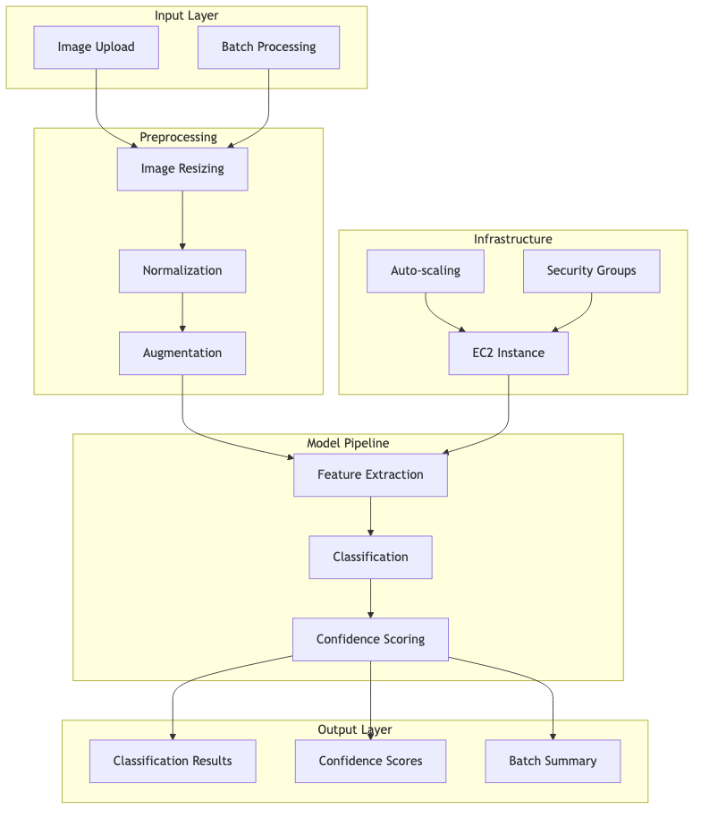

# Cloud-Native Image Intelligence Platform 🌐📸
[](LICENSE)
[](https://www.python.org/)
[](https://aws.amazon.com/ec2/)



A scalable web platform for real-time image classification using deep learning models. This application provides an intuitive interface for image analysis, deployed on AWS EC2 with auto-scaling capabilities.

## Key Features

1. **Real-time Image Classification**
   - Instant predictions using pre-trained deep learning models
   - Support for multiple image formats
   - Batch processing capabilities

2. **Cloud Deployment**
   - Deployed on AWS EC2
   - Auto-scaling capabilities
   - Secure access control

3. **Web Interface**
   - Modern, responsive UI
   - Drag-and-drop image upload
   - Batch processing interface
   - Results visualization

## Technical Stack

1. **Frontend**
   - HTML5/CSS3
   - JavaScript
   - Bootstrap for responsive design

2. **Backend**
   - Python Flask
   - TensorFlow/Keras
   - Pre-trained deep learning models

3. **Infrastructure**
   - AWS EC2
   - Security Groups
   - IAM Roles
   - Auto-scaling configuration  

## Deployment

1. **Local Development**
   ```bash
   # Clone the repository
   git clone https://github.com/Harshul-ds/ImageClassificationWebApp
   cd ImageClassificationWebApp

   # Create and activate virtual environment
   python -m venv venv
   source venv/bin/activate

   # Install dependencies
   pip install -r requirements.txt

   # Run the application
   python app.py
   ```

2. **Cloud Deployment**
   - Deploy on AWS EC2
   - Configure security groups
   - Set up auto-scaling
   - Enable monitoring and logging

## Usage

1. Access the web interface
2. Upload images through the drag-and-drop interface
3. View real-time classification results
4. Process multiple images in batch mode  

## **Future Enhancements**  
- Integrate additional deep learning models for improved accuracy.  
- Add support for multi-label classification.  
- Deploy on cloud platforms for scalability.  

## **Contributions**  
Contributions are welcome! Feel free to fork this repository, create a feature branch, and submit a pull request.  

---


